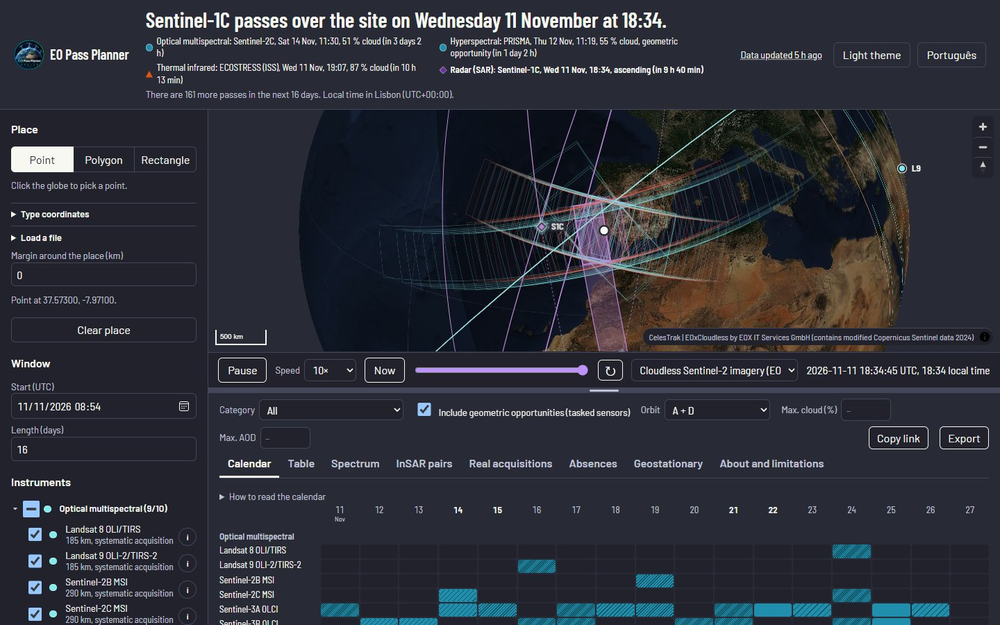
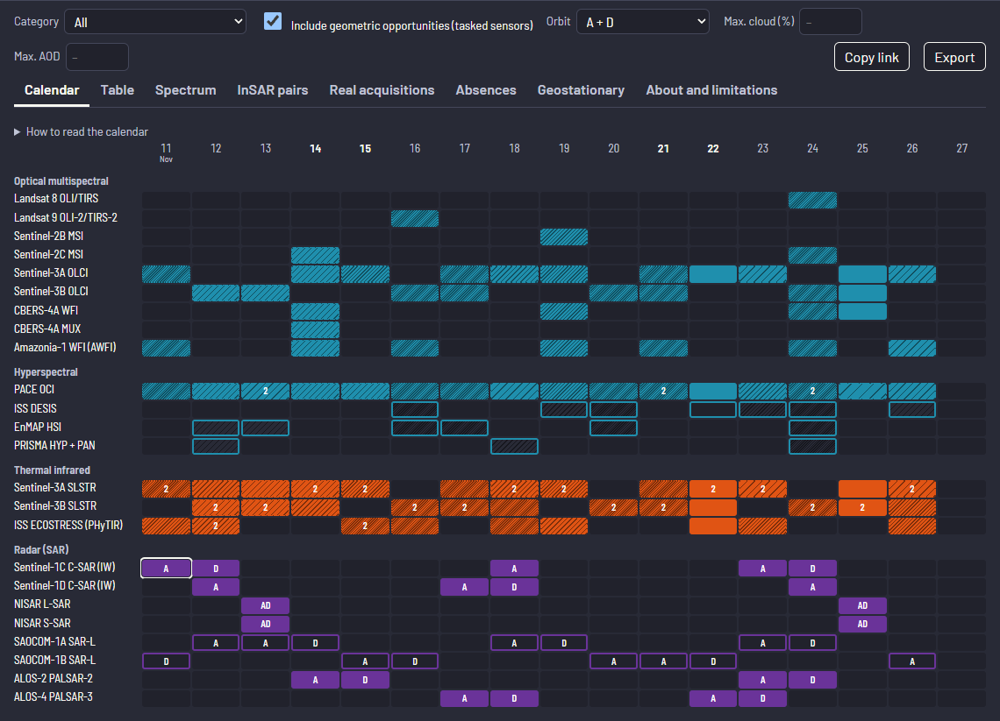
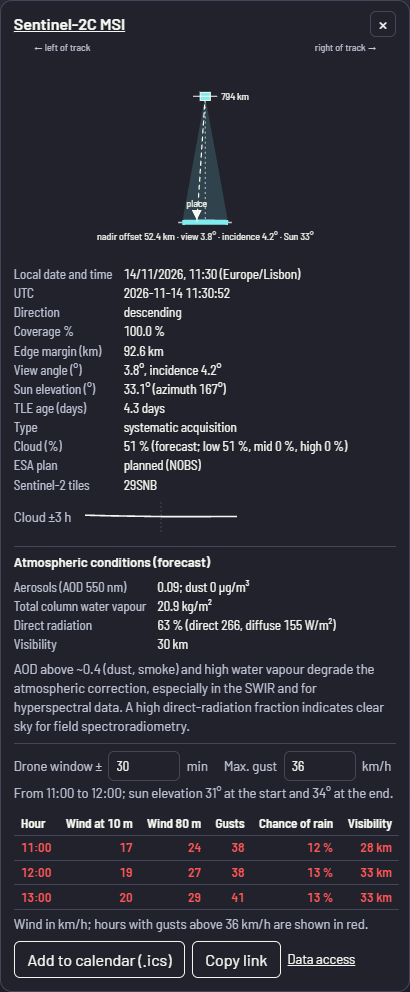

<p align="center">
  
</p>

# EO Pass Planner

**When will an Earth-observation satellite actually image my site?**

EO Pass Planner is a web application that predicts, for a point or polygon
region of interest (ROI) and a date window, which Earth-observation
instruments will image it (or have geometrically imaged it), when (UTC and
local time), with what coverage, viewing and illumination geometry, orbit
direction and expected cloud, and whether the acquisition is systematic or an
opportunity that must be tasked.

**Open the application:** <https://pedrommgoncalves.github.io/EO-Pass-Planner/>

It runs entirely in the browser: no installation, no account, no server.
Orbital data and ESA acquisition plans are refreshed every 6 h.



## Quick start

1. **Choose the place**: click the globe, draw a polygon or rectangle, type
   coordinates, or load a GeoJSON, KML, KMZ or zipped Shapefile.
2. **Choose the window and instruments**: start date, length (16 days by
   default) and the instrument categories of interest.
3. **Compute passes**: the answer bar gives the next useful pass and one line
   per instrument category; the calendar, the table and the pass details hold
   the evidence.

Example: [the next 16 days over Neves-Corvo, Portugal](https://pedrommgoncalves.github.io/EO-Pass-Planner/#roi=p:37.57300,-7.97100&d=16&l=en).
Every query and every pass has a link that reproduces it.

<table>
  <tr>
    <td width="70%"></td>
    <td width="30%"></td>
  </tr>
  <tr>
    <td><b>Revisit calendar.</b> One row per instrument and one column per local day. Colour strength gives ROI coverage, hatching forecast cloud, an outline a tasking opportunity; SAR rows mark ascending (A) and descending (D) passes.</td>
    <td><b>Pass details.</b> To-scale cross-section, geometry, cloud, ESA plan status, atmospheric conditions and a drone window.</td>
  </tr>
</table>

## Features

- **Globe** (MapLibre GL JS) with live satellite positions, ground tracks, the
  swath of each sensor while it would acquire, and the night side; offline,
  satellite-imagery and OpenStreetMap basemaps; light and dark themes.
- **Region of interest** as a point, polygon or rectangle, typed in WGS 84,
  ETRS89/PT-TM06, UTM or any proj4 definition, or read from a file; optional
  buffer.
- **Answer first**: a sentence with the earliest useful pass, one line per
  instrument category and a countdown.
- **Evidence**: revisit calendar, sortable table, pass details with a to-scale
  cross-section, spectral ruler with diagnostic mineral absorption features,
  explanation of absences ("why no pass"), geostationary view angles and
  candidate InSAR pairs.
- **Cross-checks**: ESA Sentinel-1/-2 acquisition plans (planned, not planned,
  no plan), cloud and atmospheric conditions at pass time, real past
  acquisitions from STAC catalogues, Sentinel-2 MGRS tiles, Sentinel-1
  relative orbits, Landsat WRS-2 path/row, ICESat-2 reference ground tracks and
  probable orbit manoeuvres.
- **Filters**: category, tasking opportunities, orbit direction, maximum cloud
  and maximum aerosol optical depth.
- **Exports**: CSV, iCalendar (.ics), GeoJSON footprints, a
  [GeoLibre](https://geolibre.app) project and a printable field sheet.
- **Accessibility**: colour-vision-safe category palette backed up by marker
  shapes, keyboard navigation, screen-reader labels.
- Portuguese (pt-PT) and English interface.

## Catalogue

74 entries in [`data/catalogue.json`](data/catalogue.json), each with cited
sources for its status, swath and orbit; values not yet confirmed are marked.
Satellites in commissioning or at the end of their mission are optional, and
commercial constellations are expanded to their current members when
selected.

| Category | Entries | Examples |
|---|---:|---|
| Optical multispectral | 14 | Landsat 8/9, Sentinel-2B/2C, Sentinel-3 OLCI, MODIS, CBERS-4A, PlanetScope |
| Optical very high resolution | 9 | SPOT 6, Pléiades, Pléiades Neo, SkySat, WorldView-3, WorldView Legion |
| Hyperspectral | 7 | EnMAP, PRISMA, EMIT, DESIS, PACE OCI, FLEX |
| Thermal infrared | 5 | Sentinel-3 SLSTR, ECOSTRESS |
| Radar (SAR) | 15 | Sentinel-1C/1D, NISAR, SAOCOM, ALOS-2/4, TerraSAR-X, PAZ, ICEYE, Capella, Umbra |
| Lidar and altimetry | 8 | ICESat-2, GEDI, SWOT, Sentinel-6, CryoSat-2, Sentinel-3 SRAL |
| Polar meteorological | 6 | Metop AVHRR, Metop-SG METimage, VIIRS |
| Geostationary meteorological | 3 | Meteosat MTG FCI, Meteosat SEVIRI |
| Atmosphere | 2 | Sentinel-5P TROPOMI, Sentinel-5 |
| Geophysics | 5 | Swarm, GRACE-FO |

## How it works

1. **Orbits.** Element sets from CelesTrak (TLE, or OMM for catalogue numbers
   above 99 999) are propagated with SGP4 (satellite.js) on a coarse time
   grid, refined around each approach.
2. **Swaths.** For each instrument, the swath is built across the ground track
   from its swath model: nadir-symmetric (with an optional nadir gap),
   side-looking SAR from nominal incidence angles, field of regard for tasked
   sensors (geometric opportunities only), beam profiles for lidar and
   altimeters, and view geometry for geostationary imagers.
3. **Intersection.** Swath and ROI are intersected in an equal-area projection
   centred on the ROI, which gives the coverage, the closest-approach time,
   the nadir offset, the edge margin and the viewing and solar angles.
4. **Acquisition rules.** Each entry states when it acquires (for example,
   daytime descending passes within its latitude limits), whether acquisition
   is systematic, partial or tasked, and its minimum coverage.
5. **Cross-checks.** Sentinel-1/-2 passes are compared with ESA acquisition
   plans; weather, cloud and aerosols at pass time come from Open-Meteo; past
   passes are compared with products in STAC catalogues.

Computation runs in parallel Web Workers; 16 days for the default selection
take a few seconds.

## Validation

**Against the reference implementation.** The Python engine of
[eo-overpass-predictor](https://github.com/julianManning/eo-overpass-predictor)
(pinned commit `eb6bcce`) and this JavaScript engine were run with the same
element sets over 16 days and five ROIs (Port Phillip Bay, Neves-Corvo,
Ossa-Morena, Maputo, mainland Portugal); 68 expected passes. Both found the same
passes for every ROI. Full table: [docs/oracle_residuals.md](docs/oracle_residuals.md).
CI repeats the comparison whenever the engine changes.

| Quantity (JS − reference) | mean | s.d. | max \|Δ\| |
|---|---:|---:|---:|
| Closest-approach time (s) | +0.005 | 0.027 | 0.051 |
| ROI coverage (percentage points) | −0.011 | 0.030 | 0.095 |
| Nadir offset (km) | −0.040 | 0.081 | 0.487 |
| View angle (°) | −0.003 | 0.006 | 0.031 |
| Solar elevation (°) | 0.000 | 0.030 | 0.055 |

**Against real acquisitions.** Predicted pass times were compared with 330
Sentinel-2 L2A and Landsat C2 L2 scenes over mainland Portugal from the last
16 days (Earth Search STAC), using the current element sets propagated
backwards. Full report: [docs/validation.md](docs/validation.md).

| Platform | scenes | mean Δt (s) | s.d. (s) | max \|Δt\| (s) |
|---|---:|---:|---:|---:|
| Landsat 8 | 5 | −0.52 | 0.01 | 0.53 |
| Landsat 9 | 9 | −0.45 | 0.10 | 0.57 |
| Sentinel-2A | 114 | +0.00 | 0.86 | 2.22 |
| Sentinel-2B | 119 | +0.04 | 0.79 | 2.35 |
| Sentinel-2C | 83 | −2.26 | 2.52 | 7.20 |

The error grows with the age of the element set: for Sentinel-2C the mean
|Δt| is about 1 s with element sets up to 8 days old and 4–6 s beyond, which
suggests an orbit manoeuvre in that period.

**Other checks** (in `tests/`): SGP4 positions agree with Skyfield to within
5.8 m up to 7 days from the epoch; solar elevation agrees with Skyfield/DE421
to within 0.011°.

**Performance.** Over 16 days, measured in Node 22 on a laptop: the 27 active
systematic instruments over the mainland Portugal polygon take 3.4 s (target:
under 10 s); all non-inactive entries take 6.4 s. In the browser the default
selection for a point takes about 2.6 s.

## Data and updates

| Data | Where | Updated |
|---|---|---|
| Catalogue and band tables | [`data/catalogue.json`](data/catalogue.json), [`data/bands.json`](data/bands.json) | by hand; every value cites a source, and `scripts/validate_catalogue.py` enforces the rules |
| Orbital elements, element-set archive, detected manoeuvres | `data/tles.json`, `data/tles_constellations.json`, `data/tle_history/`, `data/manoeuvres.json` | every 6 h by the [`update-data`](.github/workflows/update-data.yml) workflow, which commits the files |
| ESA acquisition plans (Sentinel-1/-2) | `data/plans/` | every 6 h, converted from the ESA KML files (`scripts/esa_plans.py`) |
| Weather, cloud, aerosols, real acquisitions, ICESat-2 tracks | requested by the page at query time | live; nothing is stored |

The workflow never overwrites good data with a failed fetch, and the page
shows the age of its data. The page requests only services that are free,
need no key and accept requests from any page (checked 2026-11-10):
Open-Meteo (forecast, ERA5 archive, CAMS air quality), Earth Search and
Copernicus Data Space STAC, NASA CMR, EOX and OpenFreeMap. Without a
connection it still computes passes from the bundled data; the live parts
stay empty.

## Limitations

- A geometric prediction is not an acquisition. Tasked missions show
  opportunities only; systematic missions can still skip acquisitions
  (manoeuvres, conflicts, downlink, campaign plans).
- Nominal swath widths are used; real edges vary by a few km (edge margins
  under 5 km are flagged as uncertain).
- SGP4 error grows with element-set age and across manoeuvres.
- SAR ground ranges are computed on a sphere from nominal incidence angles;
  terrain is ignored.
- Cloud cover is a point model value, not the cloud cover of a scene.
- ISS-hosted instruments depend on ISS attitude and operations that the
  element sets do not capture.

## Development

Static site: no build step, no framework, no runtime CDN; libraries are
vendored in [`vendor/`](vendor/). Serve the repository root with any static
server, for example

```sh
python -m http.server 8000
```

and open <http://localhost:8000/> (opening `index.html` as a file does not
work, because ES modules and `fetch` need http).

```sh
npm test                                              # JavaScript unit tests (node --test, no dependencies)
python -m unittest discover -s tests -p "test_*.py"   # Python scripts
python scripts/validate_catalogue.py                  # catalogue rules
python scripts/oracle_compare.py --oracle-dir <clone>  # comparison with the reference implementation
node scripts/ground_truth.mjs --days 16                # validation against real acquisitions
python scripts/make_sgp4_fixtures.py                   # regenerate SGP4/sun fixtures (needs skyfield)
node scripts/check_palette.mjs                         # colour-vision-deficiency check of the palette
node scripts/e2e.mjs                                   # browser test (needs playwright and a local server)
```

Continuous integration runs the unit tests on code changes, the reference
comparison ([oracle.yml](.github/workflows/oracle.yml)) when the engine
changes, and the browser test and Lighthouse audit
([e2e.yml](.github/workflows/e2e.yml)) on demand.

## Relation to eo-overpass-predictor

The method follows
[eo-overpass-predictor](https://github.com/julianManning/eo-overpass-predictor)
by Julian Manning: SGP4 propagation, swath construction across the ground
track, intersection with the ROI in a local equal-area projection, daytime
descending filters, edge margin, element-set age, the ESA plan cross-check and
time-zone-aware local times. EO Pass Planner is an independent JavaScript
implementation of that method (no code is shared), validated against it, and
extended in scope:

| | eo-overpass-predictor | EO Pass Planner |
|---|---|---|
| Form | Python, Jupyter notebooks | static web application |
| Instruments | Landsat 8/9, Sentinel-2A/B/C | 74 catalogue entries in 10 categories |
| Swath models | nadir-symmetric | nadir-symmetric, side-looking SAR, field of regard, profile, geostationary |
| ESA plans | Sentinel-2 | Sentinel-1 and Sentinel-2, refreshed every 6 h |
| Outputs | tables, CSV, GeoPackage, maps, live tracker | answer sentence, calendar, table, pass details; CSV, iCalendar, GeoJSON, GeoLibre, field sheet |
| Additional | | cloud and atmosphere, real acquisitions, InSAR pairs, spectral ruler, absences, manoeuvre detection, Portuguese and English |

## Credit

### Method

This is a clean-room reimplementation inspired by
[eo-overpass-predictor](https://github.com/julianManning/eo-overpass-predictor)
by Julian Manning (MIT,
[doi:10.5281/zenodo.23629976](https://doi.org/10.5281/zenodo.23629976)), whose
engine is used only as a validation reference. See [NOTICE](NOTICE).

### Data sources

| Data | Source | Terms / attribution |
|---|---|---|
| Orbital elements (TLE, OMM) | [CelesTrak](https://celestrak.org/) GP data (T.S. Kelso) | courtesy of CelesTrak |
| Sentinel-1 and Sentinel-2 acquisition plans | [ESA](https://sentiwiki.copernicus.eu/), Copernicus programme | © ESA |
| Weather and cloud cover, forecast | [Open-Meteo](https://open-meteo.com/), from national weather service models (ECMWF, DWD, NOAA, Météo-France and others) | CC BY 4.0, "Weather data by Open-Meteo.com" |
| Weather and cloud cover, past dates | ERA5 reanalysis, Copernicus Climate Change Service (C3S), via Open-Meteo ([Hersbach et al., 2020](https://doi.org/10.1002/qj.3803)) | Copernicus licence |
| Aerosols and dust | Copernicus Atmosphere Monitoring Service (CAMS), via Open-Meteo | Copernicus licence |
| Past Sentinel-2 and Landsat acquisitions | [Earth Search](https://earth-search.aws.element84.com/v1) STAC (Element 84): Sentinel-2 L2A (Copernicus Sentinel data, ESA) and Landsat Collection 2 Level-2 (USGS) | Copernicus licence; USGS public domain |
| Past Sentinel-1 acquisitions | [Copernicus Data Space Ecosystem](https://dataspace.copernicus.eu/) STAC, Sentinel-1 GRD | Copernicus licence |
| ICESat-2 reference ground tracks | NASA [Common Metadata Repository](https://cmr.earthdata.nasa.gov/), ATL08 granules (NSIDC DAAC) | NASA open data |
| Mission and instrument parameters | [WMO OSCAR](https://space.oscar.wmo.int/), [ESA SentiWiki](https://sentiwiki.copernicus.eu/), [eoPortal](https://www.eoportal.org/) and agency documentation (NASA, USGS, NOAA, EUMETSAT, JAXA, DLR, CNES, ASI, CONAE, INPE, ISRO) and commercial operators | cited per entry in [`data/catalogue.json`](data/catalogue.json) |
| Spectral bands | the same agency and operator sources | cited per group in [`data/bands.json`](data/bands.json) |
| Mineral absorption features | Hunt (1979, 1981), compiled in Lee and Raines (1984), USGS Open-File Reports 84-96 and 81-787; Reddy et al. (2015) | cited per feature in [`data/bands.json`](data/bands.json) |
| Offline basemap | [Natural Earth](https://www.naturalearthdata.com/) 1:110m and 1:50m | public domain |
| Satellite imagery basemap | [EOxCloudless 2024](https://cloudless.eox.at) by EOX IT Services GmbH (contains modified Copernicus Sentinel data 2024) | CC BY-NC-SA 4.0 |
| Street basemaps | [OpenFreeMap](https://openfreemap.org/), [OpenMapTiles](https://openmaptiles.org/), © [OpenStreetMap](https://www.openstreetmap.org/copyright) contributors | ODbL |

Third-party libraries and fonts: see [vendor/README.md](vendor/README.md). Dark
theme colours: [Dracula](https://draculatheme.com/) palette.

### GeoLibre

Projects can be exported to [GeoLibre](https://geolibre.app) (opengeos,
Prof. Qiusheng Wu), with thanks for that work
([doi:10.5281/zenodo.20785400](https://doi.org/10.5281/zenodo.20785400)).

## Citation

Citation metadata are in [`CITATION.cff`](CITATION.cff) (GitHub: "Cite this
repository"). Releases are archived on Zenodo.

## Licence

MIT, © 2026 Pedro Gonçalves. See [LICENSE](LICENSE).
